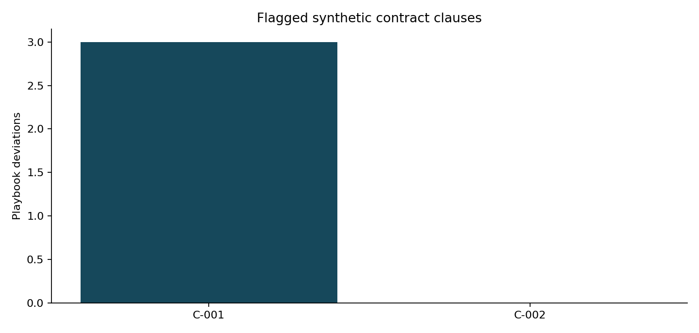

# Contract Review Agent

> Which clauses deviate from an internal playbook, with line evidence?

**Portfolio:** Tajamul Khan | [LinkedIn](https://www.linkedin.com/in/tajamulkhann/) | [GitHub](https://github.com/tajamulkhann) | [Instagram](https://www.instagram.com/tajamul.codes/)

**Level:** Intermediate to advanced engineering exercise. **Data:** Fully synthetic. **Mode:** Offline, traceable baseline. **Evaluation:** Actually executed against included fixtures.

## Project overview

Flag playbook deviations while linking every finding to an exact fictional contract line. Demonstrates clause parsing, policy matching, citations and human legal handoff.

## STAR case study

### Situation
Legal and procurement teams need consistent review triage with source lines.

### Task
Flag playbook deviations while linking every finding to an exact fictional contract line.

### Action
Retrieve contract and playbook, evaluate clause types, annotate evidence and route flagged items to human assessment.

### Result
Contract C-001 produces three cited deviations; C-002 produces no flags under the limited playbook.

In the executed local fixture evaluation, **4/4 cases passed the specified oracle checks** with a task success rate of **100%**, a tool failure rate of **10.0%** and mean end-to-end latency of **0.093 ms** (including deliberate fault-injection cases). Model API tokens were **0** and direct hosted model spend was **$0.00**, because the included run used no hosted LLM. These are measured *fixture outcomes*, not production reliability benchmarks, business savings or live-service performance.



## Data provenance and dictionary

- **Dataset:** Bundled under [`data/`](data/README.md). Inputs, source metadata and evaluation oracles are synthetic and labeled.
- **License:** Data CC0-1.0, code MIT. See [root data license](../DATA_LICENSE.md).
- **External sources:** None required. `synthetic://` source references are fictional, not externally verified URLs.
- **Success and failure outputs:** [`outputs/success.json`](outputs/success.json) and [`outputs/failure.json`](outputs/failure.json).

## Architecture

See [architecture.md](architecture.md) for the Mermaid pipeline, trust boundaries and state contract. The actual workflow is implemented in [`agent.py`](agent.py). Tool invocation is traced by [`agentic_core/runtime.py`](../agentic_core/runtime.py).

## Repository files

| Artifact | Why it exists |
|---|---|
| `agent.py` | Executable workflow, guards, explicit tool decisions and error handling |
| `tools.py` (where present) | Restricted domain tooling and validators |
| `run.py` | Local CLI and benchmark runner |
| `app.py` | Streamlit demo to execute scenarios and inspect traces |
| `analysis.ipynb` | **Executed notebook**, embedded success and injected tool-failure outputs |
| `data/README.md` | Sample data dictionary, provenance and evaluation schema |
| `data/eval_cases.json` | Reproducible tasks, expected status and assertions |
| `tests/test_agent.py` | Automated reproducibility and fault-handling checks |
| `outputs/evaluation.json` | Actual per-case result, tool trace and metrics |
| `outputs/evaluation.csv` | Flat case summary for spreadsheet or BI |
| `outputs/dashboard.html` | Standalone, offline dashboard with table filter |
| `outputs/overview.png` | Chart generated from local dataset / measured results |
| `.env.example` | Environment template, no bundled secrets |
| `architecture.md` | Mermaid workflow diagram and controls |

## Run locally

From the repository root (Python 3.11 recommended):

```bash
python -m venv .venv
source .venv/bin/activate
# Windows: .venv\Scripts\activate
python -m pip install -r requirements.txt
cd 07-contract-review-agent
python run.py                 # first example
python run.py --evaluate      # all actual fixture cases
python run.py --model-plan    # OPTIONAL hosted LLM advisory plan; requires OPENAI_API_KEY
python -m pytest -q tests     # automated suite
streamlit run app.py          # interactive demo
```

Open `outputs/dashboard.html` in your browser without a web server or external assets. For notebooks, launch JupyterLab or open `analysis.ipynb` in VS Code. The committed notebook retains executed stdout, traces and a chart.

## Measured evaluation method

1. Cases specify expected status plus substrings that must be supported by the answer and evidence.
2. All examples invoke the real `agent.run(...)` code, not handwritten final answers.
3. A separate fault case injects a named failure at an actual tool call; this is a **passing** benchmark when it returns the expected error trace.
4. The CSV and JSON capture tool failures, wall-clock latencies and spend *observed in this container run*. CPU, infrastructure and storage cost are excluded.
5. `python run_all.py` at the repository root runs the full collection; results vary slightly by machine and dependency versions.

## Safety, approval and limitations

This is keyword-based playbook screening, not qualified legal advice or general legal reasoning. See [Safety and Scope](../docs/SAFETY_AND_SCOPE.md). Approval statuses are recommendations only, never authorization for side effects. These demos should be extended with integrations, independent holdout tests, monitoring and operator access controls before considering production deployment.

## Interview preparation

- What are the exact tool affordances, failure modes and trust boundaries?
- Which fixtures constitute positive, negative and injected-fault coverage?
- How would you prevent prompt injection, unauthorized side effects and false citations for a hosted LLM agent?
- What changes would make the output trustworthy enough for regulated or high-stakes workflows?
- How would you extend the offline metrics into cost, latency and correctness SLOs in production?

### Resume bullet template

“Built a reproducible contract review agent portfolio prototype with tool-level tracing, human approval boundaries, synthetic evaluation data and an interactive Streamlit demo; verified 4/4 local fixture outcomes with stored success and failure evidence.”

## Optional hosted LLM planning

The normal run is reproducible and offline. For an additional live model-based planning layer, set `OPENAI_API_KEY` in your process environment then run `python run.py --model-plan`, or enable the optional checkbox in the Streamlit app. The model suggests an ordered subset of allowlisted tool names. `agentic_core/model_bridge.py` validates those tool names and **never executes the model's proposal**; the core workflow remains policy-controlled. Real hosted model requests may incur charges. Hosted model cost is not included in the offline evaluation reports.
