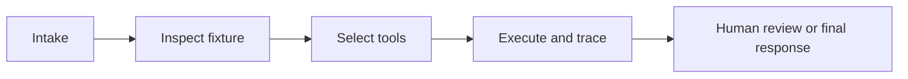

# Architecture: Data Pipeline Incident Agent

## Trust boundaries

- All examples run against local, synthetic data. Tool names are an allowlist in `agent.py`.
- `agentic_core.AgentRun.step()` records outcome, wall-clock tool latency and controlled failure injection.
- Explicit approval states are **not** permission to perform an external side effect.
- The offline mode makes **zero model API calls**. It does not measure LLM token consumption or real production costs.
- Tests use synthetic records and never send traffic to third-party services.

## State contract

`run(request, base, fault=None)` returns `status`, `answer`, `evidence`, `plan`, `trace`, `latency_ms`, `model_tokens` and `model_api_cost_usd`.
Status is one of `success`, `needs_approval`, `rejected`, `deny`, `not_found` or `error`.
